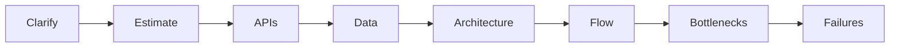

# What is System Design?

## 1. Simple Explanation

**System design** means planning how software components work together so a product can handle real users: stay fast, stay up, and grow.

You design the blueprint: APIs, databases, caches, queues, load balancers — and how they talk — not line-by-line NestJS code.

At 7+ years, the interview tests whether you can make **architectural decisions** and explain **trade-offs**, not whether you know the names of AWS services.

## 2. Practical Backend Example

You built a NestJS + PostgreSQL order API for one company (~200 RPS). It works.

Now: design checkout like a large e-commerce site (tens of thousands of RPS). Same business feature, different system: multiple API instances, cache for product reads, queue for emails, careful inventory consistency, failover for DB.

## 3. How It Works (step by step)

1. Understand what the product must do (features).
2. Understand how well it must work (latency, availability, consistency).
3. Estimate load (QPS, storage).
4. Choose components (API, DB, cache, queue…).
5. Define how a request flows through them.
6. Find what will break first under load.
7. Add scaling and failure handling.

## 4. Architecture Diagram

## 5. Why Do We Need It?

Without system design, teams scale the wrong thing, block HTTP on slow side work, create SPOFs, and discover limits in production outages.

## 6. Alternatives & Trade-offs

| Approach | When | Trade-off |
|----------|------|-----------|
| Single server | MVP / low traffic | Simple; SPOF; hard to scale |
| Modular monolith + DB | Most products early | Easy ops; scale vertically first |
| Distributed services | Clear domain boundaries + team scale | Flexibility; operational complexity |

## 7. Interview Revision Notes

- System design = blueprint for scale, speed, reliability.
- Senior signal = decisions + trade-offs + failures, not buzzwords.
- Always: clarify → estimate → design → harden.

## 8. Common Interview Q&A

**Q1. What is system design?**
Designing how components work together to meet functional and non-functional needs at scale.

**Q2. What do interviewers expect at 7+ YOE?**
Structured thinking, capacity estimates, justified choices, bottlenecks, failure handling.

**Q3. Why not start by listing Redis/Kafka?**
Tools without requirements and numbers look junior. Choose tools after clarifying load and constraints.

## 9. Practical Production Scenario

Checkout API sync-calls email + inventory + payments. P99 latency spikes when email provider slows. Fix: return after payment+order write; enqueue email; isolate inventory with clear consistency rules.

## 10. Self-Check Questions

1. In one sentence, what is system design?
2. Name the 10-step interview sequence.
3. Why are estimates done before drawing architecture?
4. What makes a senior answer different from "use Redis and Kafka"?
