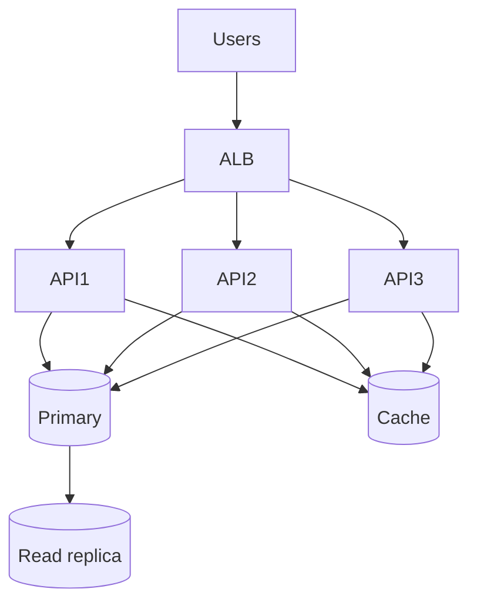

# Scalability and Availability

## 1. Simple Explanation

**Scalability:** system can handle more load by adding resources (usually more machines) without a redesign.
**Availability:** system is up and serving correctly when users need it.

Availability is often expressed as uptime percentage:
- 99% ≈ 3.65 days downtime/year
- 99.9% ≈ 8.8 hours/year
- 99.99% ≈ 52 minutes/year

## 2. Practical Backend Example

Your NestJS API on one EC2: fine at 500 RPS. At 5,000 RPS CPU saturates.
Scalability fix: multiple tasks behind ALB (horizontal scale).
Availability fix: multi-AZ ECS service + RDS Multi-AZ so one AZ failure does not take you down.

## 3. How It Works (step by step)

Scalability:
1. Measure bottleneck (CPU, DB connections, disk, lock contention).
2. Scale vertically (bigger box) or horizontally (more boxes).
3. Prefer stateless app servers so horizontal scale is easy.
4. Scale data tier with replicas/shards/partitions when needed.

Availability:
1. Remove single points of failure.
2. Replicate across AZs/regions as required.
3. Health checks + auto replace unhealthy instances.
4. Degrade gracefully (serve cached reads if possible).

## 4. Architecture Diagram

## 5. Why Do We Need It?

Traffic growth and outages are normal. Users leave slow/down products. Businesses buy scalability and availability with architecture choices.

## 6. Alternatives & Trade-offs

| Goal | Technique | Cost |
|------|-----------|------|
| Scale reads | Cache + read replicas | Stale reads possible |
| Scale writes | Shard / partition | Complexity |
| Higher availability | Multi-AZ / multi-region | Cost + replication lag |

## 7. Interview Revision Notes

- Scale = handle growth. Availability = stay up.
- Stateless APIs + LB = basic horizontal scale.
- Quote availability as nines when discussing SLAs.

## 8. Common Interview Q&A

**Q1. How do you scale a NestJS API?**
Make it stateless; put ALB/NLB in front; add instances; externalize session/cache/DB.

**Q2. Availability vs reliability?**
Availability = uptime/reachable. Reliability = correctly does the job over time (few failures).

**Q3. Why is one big server not enough?**
Ceiling on vertical scale + SPOF + maintenance downtime risk.

## 9. Practical Production Scenario

Black Friday: traffic 10×. Auto-scale ECS tasks on CPU. RDS hits connection limits → increase pool carefully + PgBouncer/RDS Proxy + cache hot product pages.

## 10. Self-Check Questions

1. Define scalability in one sentence.
2. What does 99.9% availability mean roughly per year?
3. Why must app servers be stateless to scale horizontally?
