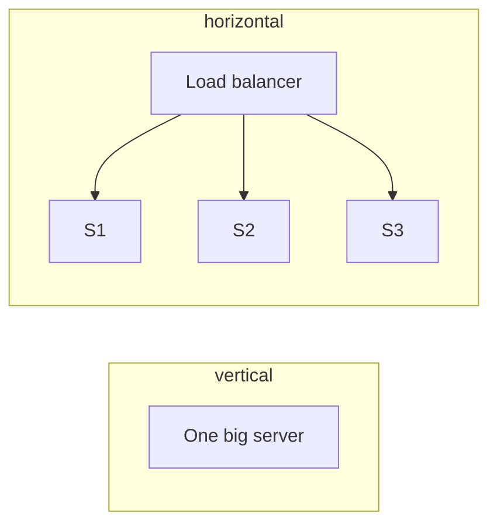

# Horizontal vs Vertical Scaling

## 1. Simple Explanation

**Vertical scaling (scale up):** make one machine bigger (more CPU/RAM).
**Horizontal scaling (scale out):** add more machines and share the work.

Node.js APIs usually scale **horizontally** because one process is single-threaded for JS CPU work (plus you want redundancy).

## 2. Practical Backend Example

One EC2 c6i.large runs NestJS + hits 80% CPU at peak.
- Vertical: move to c6i.xlarge — quick, temporary.
- Horizontal: 3× tasks behind ALB — lasting capacity + better availability.

## 3. How It Works (step by step)

Vertical:
1. Resize instance / RDS class.
2. App mostly unchanged.
3. Hard ceiling; still one failure domain.

Horizontal:
1. Make app stateless (no local session files).
2. Put load balancer in front.
3. Share state via DB/Redis.
4. Autoscale on CPU/RPS/queue depth.

## 4. Architecture Diagram

## 5. Why Do We Need It?

Traffic is spiky; hardware has limits; availability needs redundancy.

## 6. Alternatives & Trade-offs

| | Vertical | Horizontal |
|--|----------|------------|
| Speed to apply | Fast | Needs stateless design |
| Limit | Hardware ceiling | Softer limit |
| Availability | Still SPOF-ish | Better with multi-node |
| Cost pattern | Bigger boxes | More boxes |

## 7. Interview Revision Notes

- Prefer horizontal for APIs.
- Vertical is fine for quick relief or DB when sharding is premature.
- Stateless is the unlock for horizontal scale.

## 8. Common Interview Q&A

**Q1. Horizontal vs vertical?**
Vertical = bigger machine. Horizontal = more machines.

**Q2. Why is horizontal preferred for NestJS?**
Redundancy + scale beyond one box; Node concurrency model favors many processes/instances.

## 9. Practical Production Scenario

RDS CPU high. Vertical upgrade buys a week. Long-term: cache hot reads, read replicas, then consider partitioning if writes dominate.

## 10. Self-Check Questions

1. One example where vertical scaling is enough.
2. What blocks horizontal scaling of an API?
3. Where do sessions go if servers are ephemeral?
