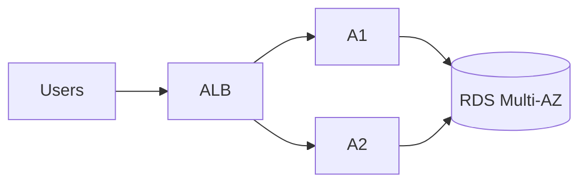

# Single Point of Failure (SPOF)

## 1. Simple Explanation

A **single point of failure** is any one component whose failure takes down the whole system (or a critical user journey).

## 2. Practical Backend Example

Everything on one EC2: app + Postgres + Redis. Instance dies → full outage. That instance is a SPOF.

Also subtle SPOFs: one AZ only; one NAT; one admin node; one shard that holds hot key without failover.

## 3. How It Works (step by step)

1. Draw dependencies for a request.
2. Mark anything with no backup/failover.
3. Replicate or multi-instance it.
4. Add health checks and automated recovery.
5. Test failover (actually practice it).

## 4. Architecture Diagram

## 5. Why Do We Need It?

Outages cost money and trust. Interviews always ask "what if this dies?"

## 6. Alternatives & Trade-offs

| SPOF | Mitigation |
|------|------------|
| One app server | ASG/ECS multi-task + ALB |
| One DB | Multi-AZ / replicas / failover |
| One cache node | Redis Cluster / ElastiCache Multi-AZ |
| One region | Multi-region if required |

## 7. Interview Revision Notes

- Ask "what if X fails?" for every box in your diagram.
- Redundancy + automated failover.
- Stateless apps make replacing failed nodes easy.

## 8. Common Interview Q&A

**Q1. What is SPOF?**
A component whose failure causes system failure.

**Q2. How do you remove SPOF from API tier?**
≥2 instances across AZs behind LB with health checks.

## 9. Practical Production Scenario

Primary RDS fails. Without Multi-AZ, minutes/hours of downtime. With Multi-AZ, failover to standby (brief interruption) and app reconnects via DNS.

## 10. Self-Check Questions

1. Identify SPOFs in: Client→One NGINX→One Nest→One Postgres.
2. Does a load balancer remove all SPOFs?
3. Can Redis be a SPOF? How to mitigate?
