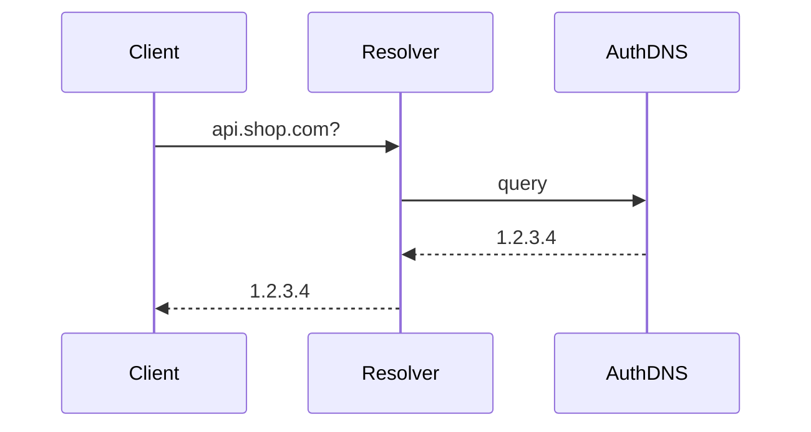

# DNS (Domain Name System)

## 1. Simple Explanation

DNS translates human names like `api.myapp.com` into IP addresses so browsers and services can connect.

## 2. Practical Backend Example

User calls `https://api.shop.com/orders`. Before TLS/HTTP, the client resolves `api.shop.com` → ALB IP(s) via DNS. In AWS, Route 53 can return different answers for failover or latency routing.

## 3. How It Works (step by step)

1. Client asks resolver: what is IP for api.shop.com?
2. Resolver queries DNS hierarchy (root → TLD → authoritative).
3. Answer is cached based on TTL.
4. Client connects to that IP.
5. On failover, DNS may point to new target after TTL expires.

## 4. Architecture Diagram

## 5. Why Do We Need It?

Users can't remember IPs. DNS also enables failover, traffic steering, and service discovery at a coarse level.

## 6. Alternatives & Trade-offs

| Approach | Pros | Cons |
|----------|------|------|
| Low TTL | Faster failover | More DNS queries |
| High TTL | Less DNS load | Slower failover |
| Latency routing | Better UX globally | Complexity |

## 7. Interview Revision Notes

- DNS = name → IP.
- TTL controls cache duration / failover speed.
- DNS failover is coarse; not a replacement for health-checked LBs inside a region.

## 8. Common Interview Q&A

**Q1. What is DNS?**
System that resolves domain names to IPs.

**Q2. How does DNS TTL affect outages?**
High TTL means clients may keep hitting old IPs after failover.

## 9. Practical Production Scenario

Primary ALB fails; Route 53 health check fails; DNS flips to secondary. Some clients still use cached IP until TTL ends.

## 10. Self-Check Questions

1. What does DNS return?
2. Trade-off of TTL=60 vs TTL=3600?
3. Is DNS enough for instant failover?
