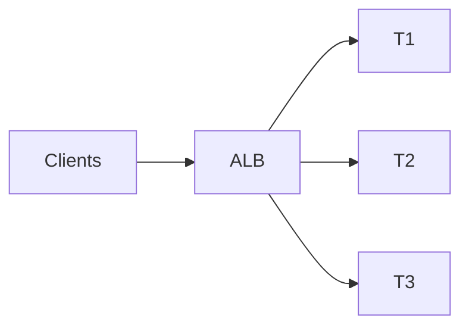

# Load Balancers

## 1. Simple Explanation

A **load balancer** sits in front of multiple servers and distributes traffic so no single instance gets all the load. It also health-checks and removes bad nodes.

## 2. Practical Backend Example

ALB in front of 8 ECS tasks running NestJS. Client hits one DNS name; ALB spreads requests. If one task fails health checks, traffic stops going there.

## 3. How It Works (step by step)

1. Client connects to LB IP/DNS.
2. LB picks a healthy target (round-robin, least connections, etc.).
3. Forwards request; returns response.
4. Continuously health-checks targets.
5. Can terminate TLS and do path-based routing (ALB).

## 4. Architecture Diagram

## 5. Why Do We Need It?

Horizontal scale + availability for the API tier.

## 6. Alternatives & Trade-offs

| Type | Layer | Example |
|------|-------|---------|
| L4 | TCP/UDP | NLB |
| L7 | HTTP | ALB, NGINX |
| DNS LB | DNS answers | Route 53 |

## 7. Interview Revision Notes

- LB + health checks = basic HA for apps.
- Prefer sticky sessions only if unavoidable; better be Stateless.
- L7 can route by path `/orders` vs `/payments`.

## 8. Common Interview Q&A

**Q1. What does a load balancer do?**
Distributes traffic across healthy backends.

**Q2. L4 vs L7?**
L4 by IP/port; L7 understands HTTP and can route on path/host/headers.

## 9. Practical Production Scenario

One Nest instance showed healthy but was stuck (high latency). Switch to better health checks + circuiting; autoscale on request count.

## 10. Self-Check Questions

1. Why health checks matter?
2. Why sticky sessions hurt scale?
3. ALB vs NLB — when each?
