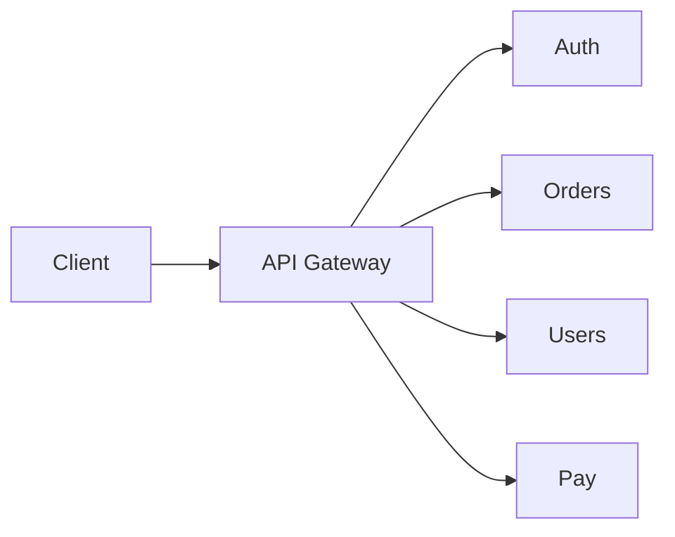

# API Gateway

## 1. Simple Explanation

An **API Gateway** is the front door for APIs: routing, auth, rate limiting, request validation, sometimes aggregation — before traffic hits microservices.

## 2. Practical Backend Example

AWS API Gateway in front of Lambda or private Nest services. It checks API keys/JWT, throttles clients, routes `/orders` to Order service.

## 3. How It Works (step by step)

1. Client calls gateway URL.
2. Gateway authenticates/authorizes.
3. Applies throttling/quotas.
4. Routes to the right service.
5. Returns response (optionally transforms).

## 4. Architecture Diagram

## 5. Why Do We Need It?

Central cross-cutting concerns so every microservice doesn't reimplement auth/rate-limit differently.

## 6. Alternatives & Trade-offs

| Approach | Pros | Cons |
|----------|------|------|
| API Gateway | Central policies | Extra hop / cost |
| Only ALB | Simpler | Less built-in API management |
| Per-service middleware | Flexible | Duplication |

## 7. Interview Revision Notes

- Gateway = policy + routing entrypoint.
- Don't put heavy business logic in the gateway.
- For a modular monolith, ALB + Nest middleware may be enough.

## 8. Common Interview Q&A

**Q1. API Gateway vs Load Balancer?**
LB spreads traffic. Gateway adds API management (auth, throttle, keys, productization).

**Q2. When skip API Gateway?**
Simple internal apps where ALB + service auth is enough.

## 9. Practical Production Scenario

Partners need keyed access + per-key 1000 RPM. API Gateway usage plans enforce this without changing Nest code.

## 10. Self-Check Questions

1. List 4 gateway responsibilities.
2. Why avoid business logic in gateway?
3. Nest monolith: gateway mandatory?
