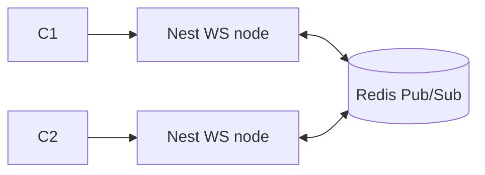

# WebSockets

## 1. Simple Explanation

**WebSockets** provide a persistent, full-duplex connection so server and client can push messages anytime — unlike request/response-only HTTP.

## 2. Practical Backend Example

Chat app typing indicators / live order tracking. Browser opens WebSocket to NestJS gateway; server pushes "driver nearby" events.

## 3. How It Works (step by step)

1. Client starts HTTP handshake with `Upgrade: websocket`.
2. Connection upgrades and stays open.
3. Either side sends messages.
4. Heartbeats detect dead connections.
5. At scale: sticky sessions or a pub/sub layer (Redis) to reach the instance holding the socket.

## 4. Architecture Diagram

## 5. Why Do We Need It?

Low-latency server push without constant polling.

## 6. Alternatives & Trade-offs

| Approach | Pros | Cons |
|----------|------|------|
| Polling | Simple | Wasteful latency/load |
| Long polling | Better than short poll | Still awkward |
| WebSocket | Realtime bi-directional | Stateful connections harder to scale |
| SSE | Simple server→client | One-way |

## 7. Interview Revision Notes

- WebSockets are stateful; scale with Redis pub/sub / managed realtime.
- Use for realtime; don't replace all REST with sockets.

## 8. Common Interview Q&A

**Q1. Why WebSockets over polling?**
Server push, less overhead, lower latency for frequent updates.

**Q2. Scaling issue?**
Connection affinity; need shared pub/sub across nodes.

## 9. Practical Production Scenario

Two ECS tasks; user connected to task A; event produced on task B. Without Redis pub/sub, user never gets the event.

## 10. Self-Check Questions

1. What does full-duplex mean?
2. Why Redis with WebSockets?
3. When is SSE enough?
