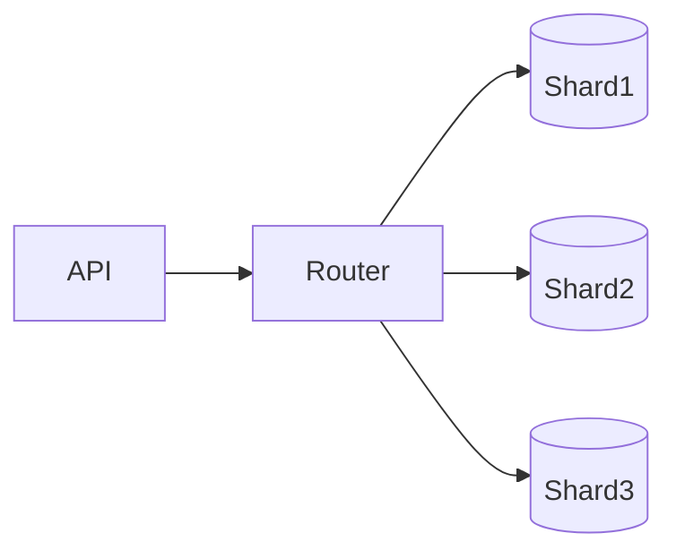

# Partitioning and Sharding

## 1. Simple Explanation

**Partitioning:** split a large table into pieces (by range/list/hash) — can be within one DB.
**Sharding:** split data across multiple database servers (each shard holds a subset).

## 2. Practical Backend Example

Orders table 2TB. Shard by `customer_id % N` across N Postgres databases so writes/storage spread.
DynamoDB does partition management for you via partition key.

## 3. How It Works (step by step)

1. Choose shard key used in most queries.
2. Route requests to correct shard.
3. Avoid queries that need all shards (scatter-gather).
4. Plan rebalancing as data grows.
5. Watch hot partitions (celebrity keys).

## 4. Architecture Diagram

## 5. Why Do We Need It?

Single primary DB hits CPU/storage/IO/connection limits.

## 6. Alternatives & Trade-offs

| Strategy | Pros | Cons |
|----------|------|------|
| Range shard | Good range scans | Hot recent range |
| Hash shard | Even distribution | Hard range queries |
| Directory | Flexible | Lookup SPOF/complexity |

## 7. Interview Revision Notes

- Shard key choice is the most important decision.
- Cross-shard transactions are hard — avoid.
- Don't shard early; scale vertical/replicas/cache first when possible.

## 8. Common Interview Q&A

**Q1. Partition vs shard?**
Partition = split data; shard usually means split across servers.

**Q2. What makes a bad shard key?**
Low cardinality or extreme skew (all traffic on one key).

## 9. Practical Production Scenario

Shard by `country`. India traffic dominates → one hot shard. Move to hash(user_id) + careful secondary indexes.

## 10. Self-Check Questions

1. Ideal properties of a shard key?
2. Why are cross-shard joins painful?
3. How does DynamoDB related to partitions?
