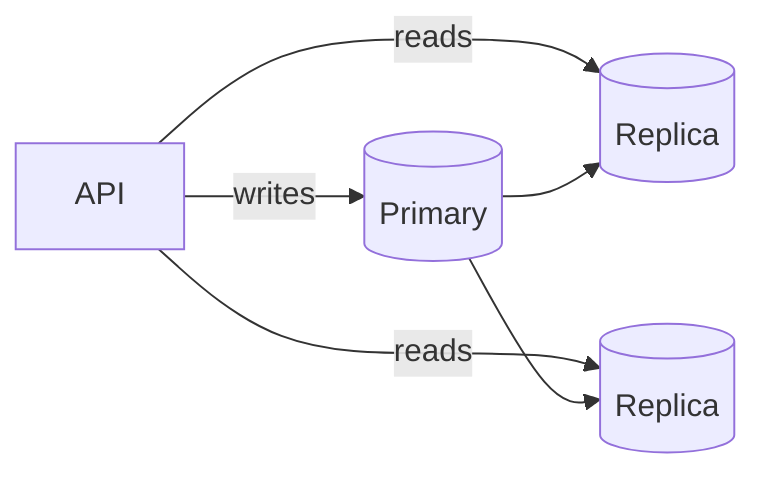

# Replication and Read Replicas

## 1. Simple Explanation

**Replication:** keep copies of data on multiple nodes.
**Primary (writer)** accepts writes; **replicas** serve reads and/or provide failover.

## 2. Practical Backend Example

RDS Postgres: app writes to primary; heavy `GET /reports` goes to read replica. If primary dies, Multi-AZ standby promotes.

## 3. How It Works (step by step)

1. Primary commits write.
2. Changes streamed to replicas (sync or async).
3. Async replicas may lag.
4. App routes reads accordingly.
5. Failover promotes a replica/standby if primary fails.

## 4. Architecture Diagram

## 5. Why Do We Need It?

Scale reads; improve availability; protect from node failure.

## 6. Alternatives & Trade-offs

| Mode | Pros | Cons |
|------|------|------|
| Async replica | Fast writes | Stale reads |
| Sync replica | Stronger durability/consistency | Higher write latency |

## 7. Interview Revision Notes

- Replicas scale reads, not writes.
- Expect replication lag.
- Critical read-after-write → primary.

## 8. Common Interview Q&A

**Q1. Do read replicas help write scaling?**
No. They help reads/HA. Writes still hit primary (until sharding).

**Q2. What is replication lag?**
Delay before replica applies primary's changes.

## 9. Practical Production Scenario

User updates address then immediately reads replica → old address. Sticky read-after-write to primary for 5s.

## 10. Self-Check Questions

1. Primary vs replica role?
2. Sync vs async trade-off?
3. Can replicas remove write bottleneck?
