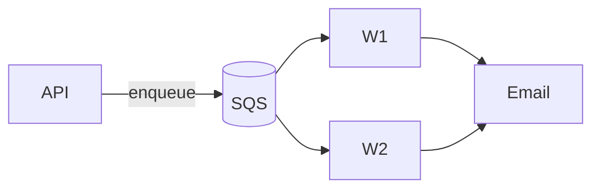

# Message Queues

## 1. Simple Explanation

A **message queue** lets one service put work into a buffer; another service processes it later. Producer and consumer don't need to be online at the same speed.

## 2. Practical Backend Example

Checkout API enqueues `OrderPlaced` to SQS; workers send email, sync CRM, generate invoice. API returns 201 quickly.

## 3. How It Works (step by step)

1. Producer sends message to queue.
2. Queue stores message durably (depending on system).
3. Consumer receives/polls message.
4. Processes; deletes/acks on success.
5. On failure, retry / DLQ.

## 4. Architecture Diagram

## 5. Why Do We Need It?

Smooth spikes; improve API latency; isolate failures; decouple services.

## 6. Alternatives & Trade-offs

| Sync call | Queue |
|-----------|-------|
| Tight coupling | Decoupled |
| Caller waits | Async processing |
| Failure cascades | Buffered retries |

## 7. Interview Revision Notes

- Use queues for slow/bursty/async work.
- Consumers must be idempotent.
- Observe queue depth as a scaling signal.

## 8. Common Interview Q&A

**Q1. Why use a queue?**
Decouple, buffer spikes, move slow work off request path.

**Q2. What if consumer is down?**
Messages wait in queue (until retention expires).

## 9. Practical Production Scenario

Email provider outage. Without queue, checkout fails. With queue, messages accumulate and drain when provider recovers.

## 10. Self-Check Questions

1. Producer vs consumer?
2. How does a queue help latency?
3. What metric scales workers?
