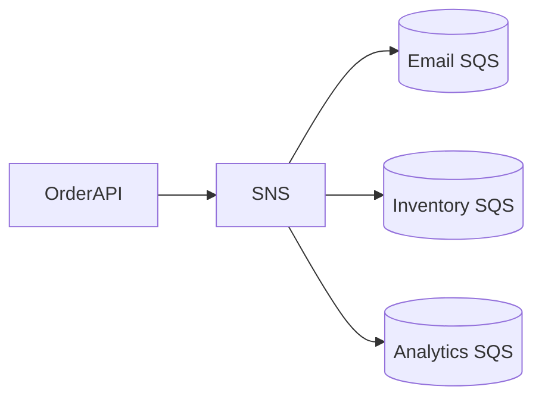

# Pub/Sub and Event-Driven Architecture

## 1. Simple Explanation

**Pub/Sub:** publisher emits an event; many subscribers receive it independently.
**Event-driven architecture:** services react to events instead of direct sync calls for everything.

## 2. Practical Backend Example

`OrderPlaced` published to SNS. SQS queues for email, inventory projection, analytics each subscribe. Checkout doesn't call them one by one.

## 3. How It Works (step by step)

1. Domain event happens.
2. Publisher puts event on bus/topic.
3. Each subscriber gets a copy (via its queue).
4. Subscribers update their own data/side effects.
5. Failures isolated per subscriber.

## 4. Architecture Diagram

## 5. Why Do We Need It?

Loose coupling; independent scaling; easier to add new consumers.

## 6. Alternatives & Trade-offs

| Sync microservice calls | Events |
|-------------------------|--------|
| Strong runtime coupling | Temporal decoupling |
| Easier immediate consistency | Eventual consistency |

## 7. Interview Revision Notes

- Pub/Sub = one event, many consumers.
- Prefer events for side effects; sync for immediate user-critical reads/writes in one service boundary.

## 8. Common Interview Q&A

**Q1. Pub/Sub vs queue?**
Queue usually one consumer group processes a message; pub/sub fans out to many.

**Q2. SNS + SQS?**
SNS fanout to multiple SQS queues (durable per consumer).

## 9. Practical Production Scenario

Adding loyalty points service: subscribe new queue to `OrderPlaced` — no change to checkout code.

## 10. Self-Check Questions

1. Benefit of event-driven?
2. Consistency downside?
3. Example event names for e-commerce?
