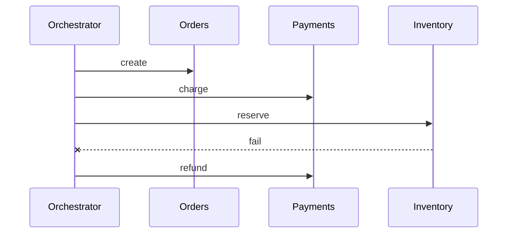

# Distributed Transactions and Saga Pattern

## 1. Simple Explanation

Across microservices you usually **cannot** use one ACID transaction.
A **saga** breaks a business flow into steps; each step has a **compensating action** if something later fails.

## 2. Practical Backend Example

Create order → charge payment → reserve inventory.
If inventory fails after payment, saga triggers refund (compensation).

## 3. How It Works (step by step)

Choreography:
1. OrderPlaced event → Payment service charges → emits PaymentCaptured → Inventory reserves…
Orchestration:
1. Order orchestrator calls each step; on failure calls compensations in reverse.

## 4. Architecture Diagram

## 5. Why Do We Need It?

Keep business correctness without 2PC across services.

## 6. Alternatives & Trade-offs

| 2PC / XA | Saga |
|----------|------|
| Strong consistency | Eventual |
| Couples availability | More resilient |
| Rare in modern cloud | Common |

## 7. Interview Revision Notes

- Prefer single-service transactions when possible.
- Saga = sequence + compensations.
- Make each step idempotent.

## 8. Common Interview Q&A

**Q1. What is a saga?**
Distributed workflow with compensations instead of one global lock/transaction.

**Q2. Choreography vs orchestration?**
Events vs central coordinator.

## 9. Practical Production Scenario

Payment succeeded, inventory failed; refund compensation delayed → user sees "processing" until saga completes.

## 10. Self-Check Questions

1. Why not 2PC in microservices?
2. Example compensation for seat booking?
3. Failure if compensation fails?
