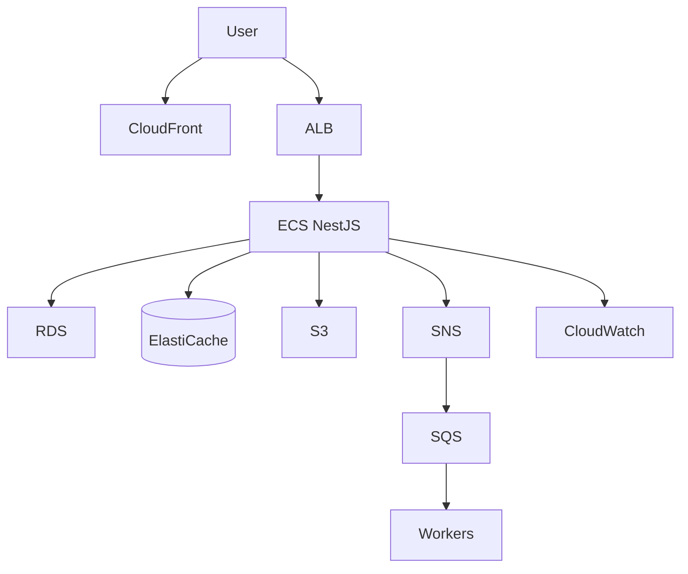

# AWS Services — Practical Usage for Backend Engineers

## 1. Simple Explanation

These AWS services are the building blocks interviewers expect you to wire into a coherent production design — not memorize as a dictionary.

## 2. Practical Backend Example

Typical NestJS product on AWS:
- ECS/Fargate tasks for API
- ALB in front
- RDS Postgres for relational data
- ElastiCache Redis for cache/rate limits
- S3 + CloudFront for media
- SQS/SNS for async
- CloudWatch for logs/metrics/alarms
- API Gateway when exposing Lambda or partner APIs

## 3. How It Works (step by step)

**EC2:** raw VMs. Use when you need full control; more ops work.
**ECS:** runs containers (your Nest Docker image) with scheduling on EC2 or Fargate.
**ALB:** L7 load balancer for HTTP to ECS/EC2; health checks; path routing; TLS.
**API Gateway:** managed front door for APIs (esp. Lambda); auth, throttle, keys.
**Lambda:** run code without managing servers; great for spiky async/events; watch cold starts/timeouts.
**S3:** durable object storage for files/images/backups.
**CloudFront:** CDN in front of S3/ALB.
**RDS:** managed relational DB (Postgres/MySQL) with Multi-AZ, replicas, backups.
**DynamoDB:** managed NoSQL; partition-key scale; single-digit ms at scale.
**ElastiCache:** managed Redis/Memcached.
**SQS:** managed queue.
**SNS:** pub/sub fanout (often to SQS).
**CloudWatch:** metrics, logs, alarms.

## 4. Architecture Diagram

## 5. Why Do We Need It?

Managed services reduce ops toil and encode HA patterns (Multi-AZ, backups) you'd otherwise build yourself.

## 6. Alternatives & Trade-offs

| Need | Prefer |
|------|--------|
| Long-running API | ECS/EKS/EC2 + ALB |
| Event worker | Lambda or ECS consumers |
| Relational + joins | RDS |
| Key-value mega scale | DynamoDB |
| Cache | ElastiCache Redis |
| Async | SQS (+ SNS) |
| Static media | S3 + CloudFront |

## 7. Interview Revision Notes

- Map each service to a problem it solves.
- Combine: ALB→ECS→RDS+Redis; events via SNS/SQS; media S3/CF; observe with CloudWatch.
- Prefer managed HA features (Multi-AZ) in designs.

## 8. Common Interview Q&A

**Q1. ECS vs Lambda for API?**
ECS for steady low-latency long-lived APIs; Lambda for event-driven/spiky/light APIs with timeout limits.

**Q2. RDS vs DynamoDB?**
RDS for relational/ACID/complex queries; DynamoDB for known access patterns at massive scale.

**Q3. SQS vs SNS?**
SQS = queue. SNS = broadcast to many subscribers.

## 9. Practical Production Scenario

Image upload: API gets presigned S3 URL → client uploads to S3 → S3 event to Lambda → resize → save variants → CloudFront serves.

## 10. Self-Check Questions

1. What sits in front of ECS tasks?
2. Why Multi-AZ RDS?
3. How do SNS and SQS work together?
4. Where do you put Redis on AWS?
