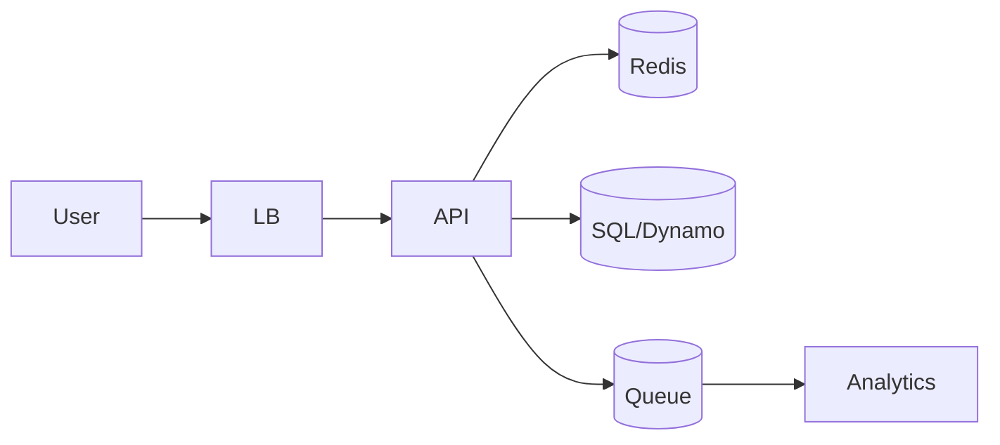

# HLD: URL Shortener (bit.ly-style)

Follow the interview sequence. Numbers are illustrative — always state assumptions.

## 1. Clarify Functional Requirements
In scope: create short URL; redirect; optional basic click count.
Out of scope (ask): custom aliases, user accounts, advanced analytics — unless interviewer wants them.

## 2. Non-Functional Requirements
- Redirect latency p99 < 100ms
- High availability
- Read-heavy (assume 10:1 to 100:1)
- Short codes unpredictable (not sequential)

## 3. Traffic & Storage Estimates
Assume:
- 100M new URLs/month ≈ ~40 writes/sec avg (peak 400/sec)
- 100:1 reads → ~4k redirects/sec avg (peak 40k/sec)
- Store ~100M × 100B ≈ 10GB (+ indexes/analytics)

## 4. APIs
- `POST /urls` `{longUrl}` → `{code, shortUrl}`
- `GET /{code}` → 302 to long URL
- `GET /{code}/stats` (optional)

## 5. Data Model
Table `urls(code PK, long_url, created_at, expires_at, click_count)`
Index: PK on code. Optionally unique on long_url hash if deduping.

## 6. High-Level Architecture

Components: Client → LB → URL service → Redis (code→url) → DB. Counter via async events optional.

## 7. Request / Data Flow
Create: API generates unique code (base62 of random/snowflake) → write DB → cache → return.
Redirect: read cache → on miss DB → cache → HTTP 302. Increment clicks async.

## 8. Bottlenecks
- DB hotspot on writes if sequential IDs
- Cache miss storms
- Collisions on code generation

## 9. Scaling Strategies
- Cache redirects aggressively
- Horizontal scale stateless API
- Shard DB by code hash if huge
- Separate analytics path

## 10. Failures & Trade-offs
- DB down: serve from cache for hot codes; fail creates
- Duplicate codes: unique constraint + retry
- Trade-off: eventual click counts vs exact

## Interview Revision Notes
- Key design is code uniqueness + cache for redirects.
- Prefer random/base62 codes over incrementing.
- 302 vs 301 matters for caching behavior.
