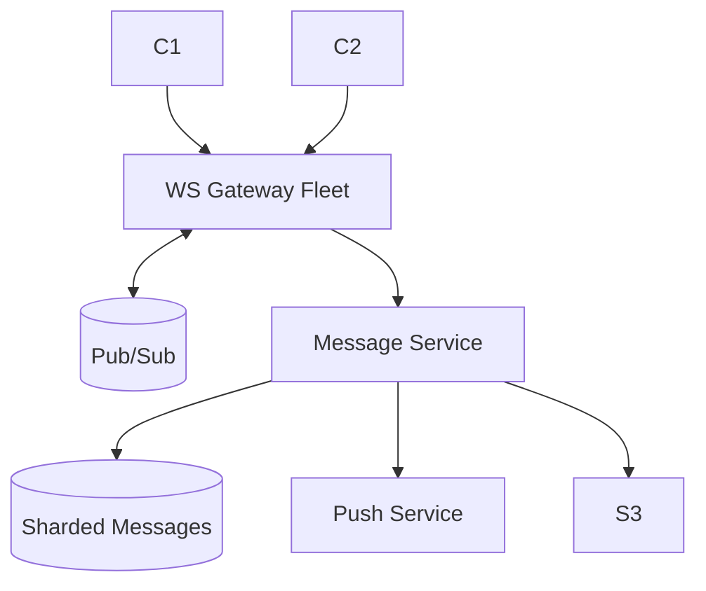

# HLD: WhatsApp / Chat Application

Follow the interview sequence. Numbers are illustrative — always state assumptions.

## 1. Clarify Functional Requirements
1:1 messaging, delivery status, online presence (basic groups optional). Media optional stretch.

## 2. Non-Functional Requirements
- Message delivery low latency (< few hundred ms on good network)
- Ordering per conversation
- High connection count (WebSockets)
- Durable message history

## 3. Traffic & Storage Estimates
Assume 50M DAU; 20 msgs/user/day → 1B msgs/day ≈ 12k msgs/sec avg (peak ~50k+).
Storage: 1KB/msg × 1B/day = 1TB/day raw (compress/retention policies).

## 4. APIs
- `POST /conversations/{id}/messages`
- WebSocket gateway for push
- `GET /conversations/{id}/messages?cursor=`
- Presence: heartbeat via WS

## 5. Data Model
`messages(conv_id, msg_id, sender_id, body, created_at, status)`
PK/SK: conv_id + msg_id (time-sortable).
`user_conversations` for inbox list.
`devices` for push tokens.

## 6. High-Level Architecture

WS gateway fleet + Redis pub/sub; message service; Cassandra/Dynamo/Postgres partitioned store; push via FCM/APNs; S3 for media.

## 7. Request / Data Flow
Send: client WS/HTTP → message service persists → fanout to recipient connections via pub/sub → push notify if offline → ack delivered/read.

## 8. Bottlenecks
- Millions of WS connections
- Fanout for groups
- Hot conversations
- Media bandwidth

## 9. Scaling Strategies
- Shard message DB by conv_id
- Sticky or pub/sub for WS nodes
- Separate media path via S3/CDN
- Group fanout async

## 10. Failures & Trade-offs
- At-least-once delivery + idempotent msg ids
- WS node death: reconnect + catch-up from DB
- Trade-off: presence freshness vs load

## Interview Revision Notes
- Chat = persistent WS + durable store + pub/sub.
- Order by conversation, not global.
- Offline = push + sync on reconnect.
