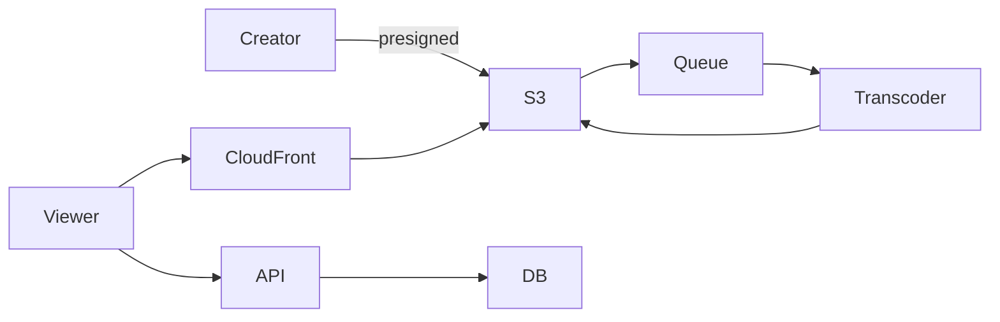

# HLD: YouTube / Video Streaming

Follow the interview sequence. Numbers are illustrative — always state assumptions.

## 1. Clarify Functional Requirements
Upload video; process encodings; stream playback; basic view count. Comments/recommendations optional.

## 2. Non-Functional Requirements
- Upload resilient for large files
- Playback start fast (TTFF)
- Global scale via CDN
- Processing async

## 3. Traffic & Storage Estimates
Assume 1M DAU watching; avg bitrate 3Mbps; peak concurrent 100k → ~300Gbps egress (CDN absorbs).
Metadata small; object storage huge (PBs).

## 4. APIs
- Presigned upload init/complete
- `GET /videos/{id}` metadata
- Player fetches HLS/DASH playlist from CDN

## 5. Data Model
`videos(id, owner_id, title, status, duration)`
`video_assets(video_id, rendition, s3_key)`
`views` aggregated async.

## 6. High-Level Architecture

Client → API → S3 upload; S3 event → transcode workers; outputs to S3; CloudFront; metadata DB; view events queue.

## 7. Request / Data Flow
Upload via presigned S3 → processing pipeline creates multi-bitrate HLS → CDN serves segments → player adaptive bitrate.

## 8. Bottlenecks
- Transcode CPU cost
- Storage + egress cost
- Hot popular video origin load (CDN mitigates)

## 9. Scaling Strategies
- CDN always
- Separate transcode fleet / Elastic Transcoder / MediaConvert
- Cache metadata

## 10. Failures & Trade-offs
- Transcode failure → retry/DLQ; status=failed
- Partial upload → multipart + lifecycle cleanup
- Trade-off: more renditions = cost vs quality

## Interview Revision Notes
- Never stream large media through API servers.
- Presigned S3 + CDN + async transcode is the core answer.
