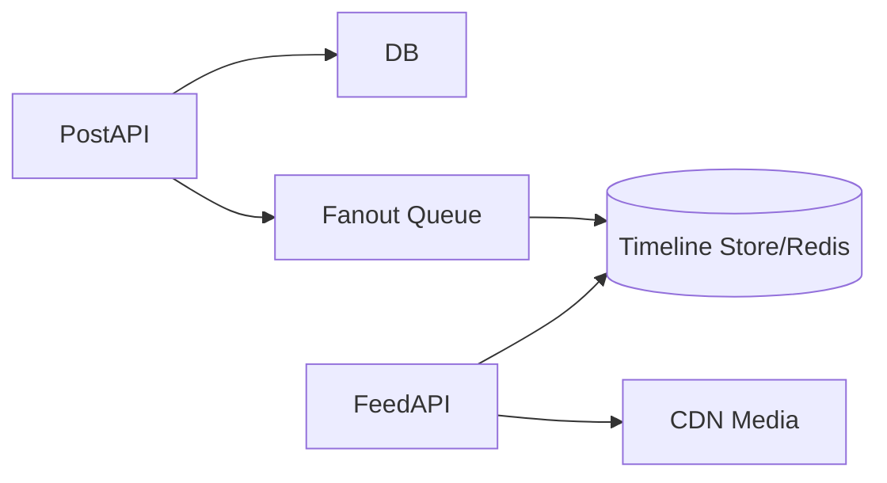

# HLD: Instagram / Social Media Feed

Follow the interview sequence. Numbers are illustrative — always state assumptions.

## 1. Clarify Functional Requirements
Post photo; follow users; see home feed. Like/comment optional.

## 2. Non-Functional Requirements
- Feed read latency low
- Write fanout vs read fanout trade-off
- Media via CDN
- Eventual consistency OK for feed freshness seconds

## 3. Traffic & Storage Estimates
Assume 100M DAU; 5 feed refreshes/day; avg 20 posts fetched → heavy read QPS.
Celebrity with 10M followers makes naive write-fanout expensive.

## 4. APIs
- `POST /posts`
- `GET /feed`
- `POST /follow/{userId}`
- Media upload presigned

## 5. Data Model
`users`, `followers(follower, followee)`, `posts(post_id, user_id, media, created_at)`
`feed_timeline(user_id, post_id, created_at)` for precomputed feeds.

## 6. High-Level Architecture

API + DB + Redis feed cache + S3/CF media + async fanout workers.

## 7. Request / Data Flow
Post created → store post → enqueue fanout → insert into followers' timeline caches (for normal users). Celebrity: read-time merge.

## 8. Bottlenecks
- Celebrity fanout explosion
- Feed cache invalidation
- Storage of timelines

## 9. Scaling Strategies
- Hybrid fanout (push for normals, pull for celebs)
- Redis cache latest N posts
- Shard timelines by user_id

## 10. Failures & Trade-offs
- Fanout lag → user sees post seconds later
- Cache miss → rebuild from DB
- Trade-off: storage (push) vs read CPU (pull)

## Interview Revision Notes
- Feed design = fanout strategy.
- Hybrid push/pull is the senior answer.
- Media always CDN.
