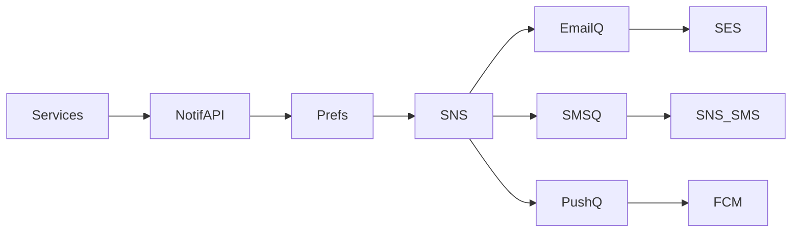

# HLD: Notification System

Follow the interview sequence. Numbers are illustrative — always state assumptions.

## 1. Clarify Functional Requirements
Send email/SMS/push/in-app notifications from many producer services; user preferences; templates.

## 2. Non-Functional Requirements
- High throughput bursts
- Prefer delivery over perfect sync
- Per-channel retries
- Respect preferences/unsubscribe

## 3. Traffic & Storage Estimates
Assume 50M notifs/day ≈ 600/sec avg; peak 10k/sec during campaigns.

## 4. APIs
- `POST /notifications` (internal)
- `GET/PUT /preferences`
- Webhook callbacks from providers

## 5. Data Model
`notification_events`, `delivery_attempts`, `preferences(user_id, channel, enabled)`, idempotency keys.

## 6. High-Level Architecture

Producers → API/event bus → preference filter → channel queues (email/SMS/push) → providers → status callbacks → DLQ.

## 7. Request / Data Flow
Event in → check prefs → template render → enqueue channel → provider send → update status; retries with backoff.

## 8. Bottlenecks
- Provider rate limits
- Template render CPU
- Duplicate sends

## 9. Scaling Strategies
- Partition queues by channel
- Autoscale workers on depth
- Provider pools + circuit breakers

## 10. Failures & Trade-offs
- At-least-once → idempotency keys to providers
- Poison templates → DLQ
- Trade-off: immediate vs batched email

## Interview Revision Notes
- Notifications are an async multi-channel pipeline.
- Preferences + idempotency + DLQ are must-mention.
