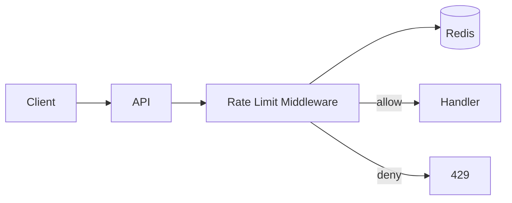

# HLD: Rate Limiter

Follow the interview sequence. Numbers are illustrative — always state assumptions.

## 1. Clarify Functional Requirements
Limit requests per key (IP/user/API key) over a window; return allow/deny. Used as middleware or service.

## 2. Non-Functional Requirements
- Very low added latency
- Correct under many API instances
- Configurable limits per route
- Predictable 429 behavior

## 3. Traffic & Storage Estimates
Assume protected API 100k RPS; rate limiter must handle same order of checks.

## 4. APIs
- Middleware check before handler
- Or `POST /check {key, cost}` for centralized limiter

## 5. Data Model
Redis keys like `rl:{key}:{window}` counters; or token bucket hash fields.

## 6. High-Level Architecture

API nodes → Redis (shared). Optionally local token cache for rough prefilter.

## 7. Request / Data Flow
On request: identify key → INCR/token take → if exceed, 429; else proceed. Sync config from store.

## 8. Bottlenecks
- Redis hotspot keys
- Fixed window burst at boundaries
- Clock skew

## 9. Scaling Strategies
- Shard Redis / key hashing
- Sliding window or token bucket
- Hierarchical limits (user + IP)

## 10. Failures & Trade-offs
- Redis down: fail open vs fail closed (product decision)
- Trade-off: accuracy vs latency

## Interview Revision Notes
- Distributed rate limit = Redis.
- Mention algorithm + failure mode.
- 429 + Retry-After.
