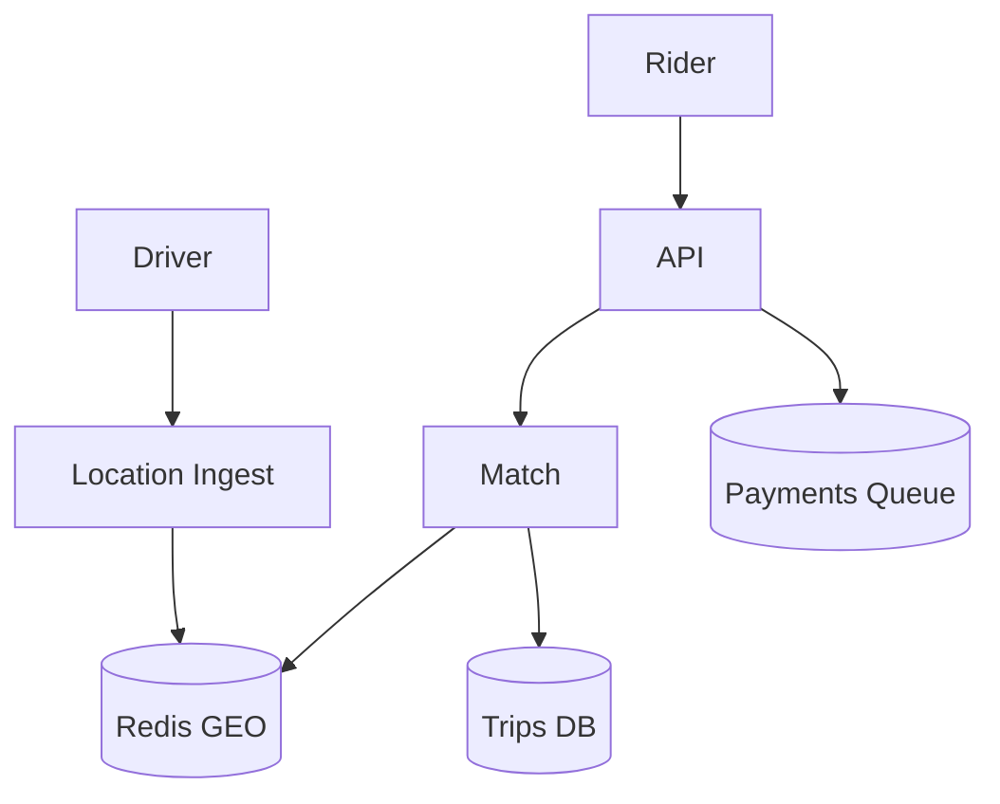

# HLD: Ride Booking Application (Uber-style)

Follow the interview sequence. Numbers are illustrative — always state assumptions.

## 1. Clarify Functional Requirements
Rider requests ride; match nearby driver; trip lifecycle; pricing basic; location updates.

## 2. Non-Functional Requirements
- Matching latency few seconds
- Fresh driver locations
- Strong correctness on accept (no double assign)
- High write rate of location pings

## 3. Traffic & Storage Estimates
Assume city: 10k drivers ping 1–4/sec → 10–40k location writes/sec.
Rides much fewer than pings.

## 4. APIs
- `POST /rides`
- `POST /rides/{id}/accept`
- WS/SSE for status
- Driver location ingest API

## 5. Data Model
`rides`, `drivers`, `ride_events`
Location store: Redis geo / tile indexes (ephemeral).
Durable trip in SQL.

## 6. High-Level Architecture

Rider API; matching service; location service (Redis GEO); dispatch; payments async; maps provider.

## 7. Request / Data Flow
Request ride → match candidates via geo query → offer to drivers → first accept wins (lock) → trip start/end → charge.

## 8. Bottlenecks
- Location write firehose
- Double-accept races
- Surge pricing hotspots

## 9. Scaling Strategies
- Separate location path from core SQL
- Partition by city/region
- Idempotent accept with row lock/version

## 10. Failures & Trade-offs
- Matching service crash: retry match; ride state machine
- Payment fail after trip: async retry + debt state
- Trade-off: matching optimality vs speed

## Interview Revision Notes
- Geo index for nearby drivers (Redis GEO).
- Ride state machine + optimistic locking on accept.
- Location data ephemeral vs trip durable.
