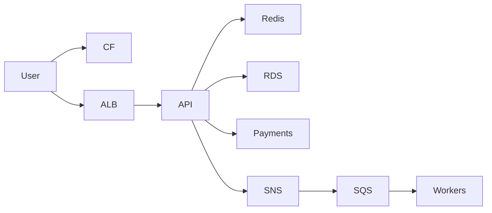

# HLD: E-commerce Application

Follow the interview sequence. Numbers are illustrative — always state assumptions.

## 1. Clarify Functional Requirements
Catalog browse; cart; checkout; payments; order history; inventory reservation. Search optional.

## 2. Non-Functional Requirements
- Checkout correctness (inventory/payment)
- Browse highly available & cached
- Spiky traffic (sales)
- Async notifications

## 3. Traffic & Storage Estimates
Assume 1M DAU; 2% convert; peak 5k checkouts/min during sale; browse 50k RPS.

## 4. APIs
- Catalog GETs
- Cart CRUD
- `POST /checkout`
- `GET /orders/{id}`

## 5. Data Model
SQL: users, products, inventory, carts, orders, order_items, payments.
Cache product pages in Redis.
Idempotency keys on checkout.

## 6. High-Level Architecture

CloudFront+ALB+ECS; Redis; RDS primary/replicas; payment PSP; SNS/SQS for email/inventory projections.

## 7. Request / Data Flow
Browse: CDN/cache → API → replica/cache.
Checkout: validate cart → begin tx/reserve inventory → charge payment → create order → enqueue confirmation.

## 8. Bottlenecks
- Inventory double-sell
- Payment timeouts
- DB write bottleneck on flash sales

## 9. Scaling Strategies
- Cache catalog aggressively
- Queue non-critical work
- Conditional inventory updates
- Optional shard orders by customer_id later

## 10. Failures & Trade-offs
- Payment success + order write fail → reconciliation job
- Idempotent checkout keys
- Trade-off: oversell risk vs locking latency

## Interview Revision Notes
- Separate read-heavy catalog from write-heavy checkout.
- Idempotency + inventory conditional update.
- Async post-order side effects.
