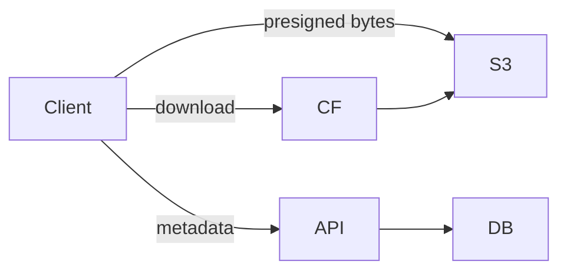

# HLD: File Storage System (Dropbox-style)

Follow the interview sequence. Numbers are illustrative — always state assumptions.

## 1. Clarify Functional Requirements
Upload/download files; folders; sharing links; versioning basic; dedupe optional.

## 2. Non-Functional Requirements
- Large file support (multipart)
- Durability (11 nines style via object store)
- Metadata strong enough for listing
- Secure sharing

## 3. Traffic & Storage Estimates
Assume 10M users × 5GB avg = 50PB logical (dedupe/compression may reduce).
Metadata much smaller in DB.

## 4. APIs
- Init multipart upload / complete
- `GET download` (presigned)
- `POST /share`
- `GET /list?prefix=`

## 5. Data Model
Metadata DB: `files`, `folders`, `versions`, `permissions`, `blocks` (if chunked).
Blobs in object storage keyed by content hash.

## 6. High-Level Architecture

Client → API (metadata) → S3 for bytes; CloudFront for downloads; antivirus workers optional.

## 7. Request / Data Flow
Upload: client requests presigned URLs for chunks → upload to S3 → complete → API commits metadata version.
Download: authz check → presigned URL/CDN.

## 8. Bottlenecks
- Metadata listing at scale
- Hot shared files
- Consistency between metadata and blobs

## 9. Scaling Strategies
- Object storage for bytes always
- Shard metadata by user_id
- CDN for popular public files
- Chunk + dedupe for efficiency

## 10. Failures & Trade-offs
- Orphan blobs: GC lifecycle
- Partial upload: abandon incomplete multipart
- Trade-off: sync complexity vs simplicity

## Interview Revision Notes
- Never pipe all bytes through app servers.
- Metadata DB + object store split is the core.
- Presigned URLs + permissions checks.
