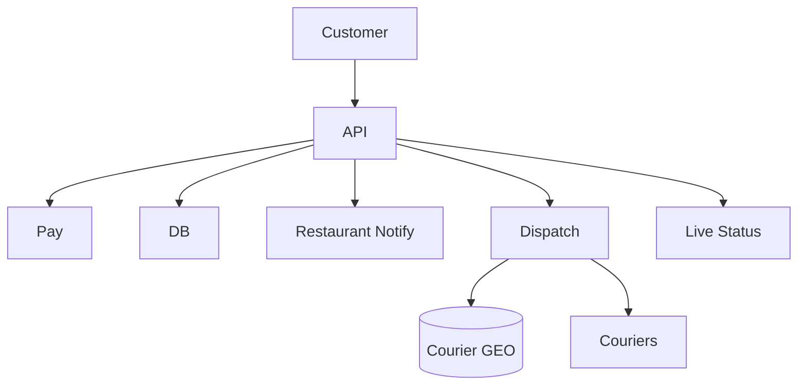

# HLD: Food Delivery Application

Follow the interview sequence. Numbers are illustrative — always state assumptions.

## 1. Clarify Functional Requirements
Browse restaurants; place order; restaurant accept; driver assign; live status; payments.

## 2. Non-Functional Requirements
- Order state machine reliability
- Geo matching for couriers
- Peak dinner surge
- ETA estimates approximate OK

## 3. Traffic & Storage Estimates
Assume city: 100k orders/day ≈ 1–2/sec avg; peak 20–50/sec.
Location pings similar to ride sharing but smaller fleet.

## 4. APIs
- Catalog/search
- `POST /orders`
- Restaurant/driver status APIs
- WS updates to customer

## 5. Data Model
`restaurants`, `menus`, `orders`, `order_items`, `couriers`, `delivery_tasks`.
Redis for courier geo & active order status.

## 6. High-Level Architecture

Customer API; restaurant service; dispatch; payment; notification; geo/location; CDN for food images.

## 7. Request / Data Flow
Place order → pay → notify restaurant → accept → dispatch courier (geo) → pickup/dropoff events → complete.

## 8. Bottlenecks
- Dinner peak
- Dispatch quality vs speed
- Menu/catalog cache invalidation

## 9. Scaling Strategies
- Cache menus
- City partitioning
- Autoscale dispatch workers
- Async notifications

## 10. Failures & Trade-offs
- Restaurant never accepts → timeout cancel + refund saga
- Courier cancel mid-route → reassign
- Trade-off: batching couriers vs ETA

## Interview Revision Notes
- Order state machine + saga for pay/cancel.
- Geo dispatch like rides but with restaurant node.
- Peak-load ready with cache + queues.
